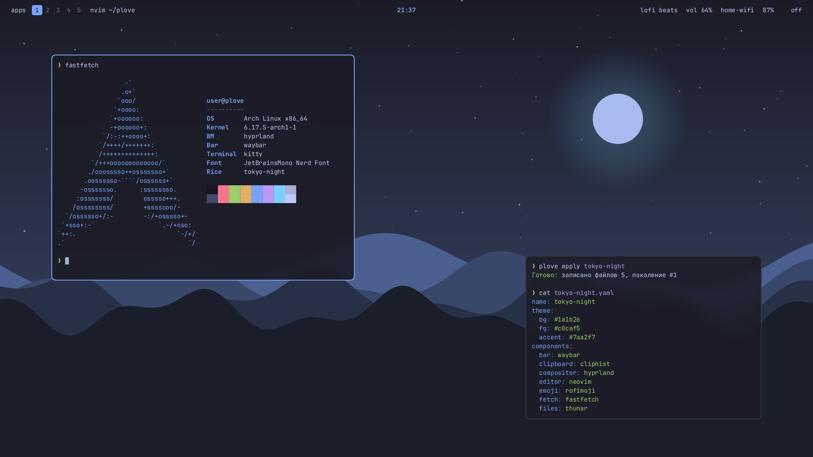
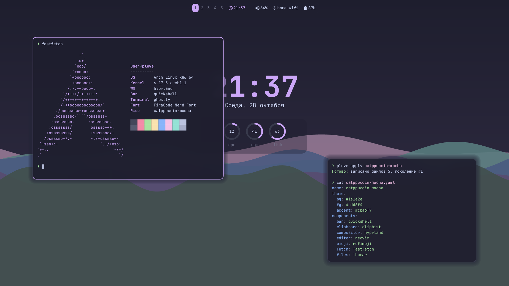
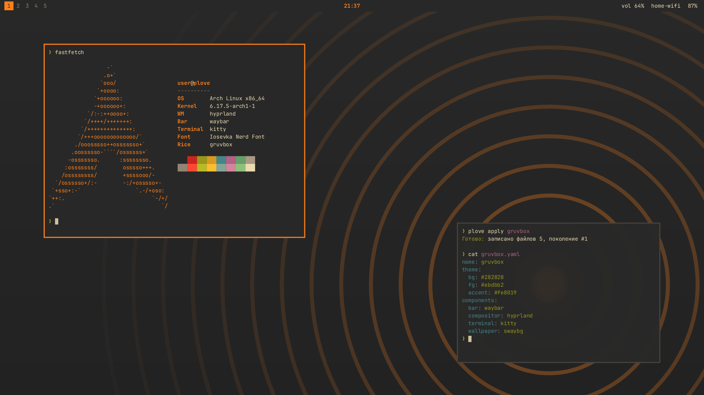
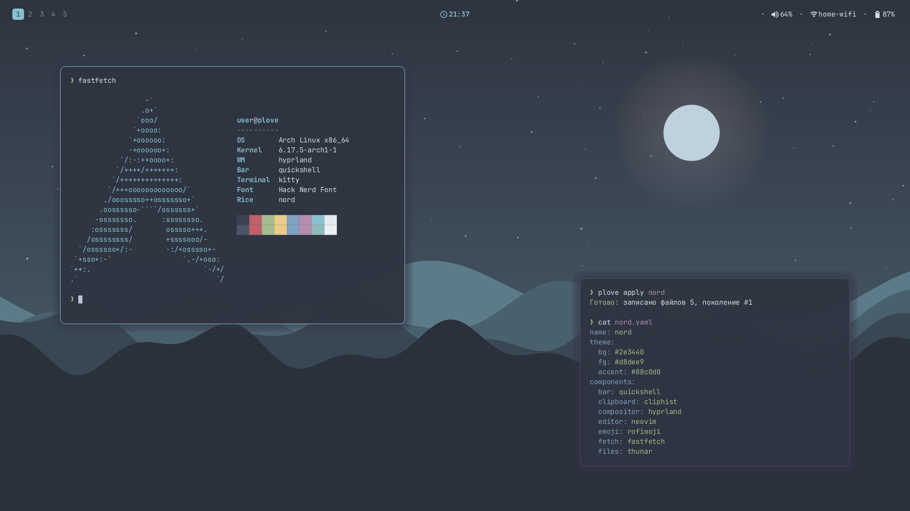

# plove

Конструктор райсов для Arch Linux: описываешь рабочий стол одним YAML-файлом, plove ставит пакеты и пишет конфиги.

> Ранняя версия: ядро, CLI, TUI-мастер, 4 готовых райса и превью.

## Готовые райсы

| tokyo-night | catppuccin-mocha |
| --- | --- |
|  |  |
| **gruvbox** | **nord** |
|  |  |

Это превью, которые рисует сама plove (`plove preview <райс>`), а не скриншоты: настоящий рабочий стол выглядит так же по цветам, обоям и геометрии, но содержимое окон выдумано.

## Быстрый старт

```sh
cargo build --release
# Мастер: проверка системы, выбор райса и настроек, план, применение:
./target/release/plove
# Проверить систему отдельно (и починить то, что можно, с --fix):
./target/release/plove doctor
# Готовые райсы:
./target/release/plove presets
# Нарисовать превью в tokyo-night.png:
./target/release/plove preview tokyo-night
# Посмотреть, что изменится, ничего не трогая:
./target/release/plove plan tokyo-night
# Попробовать в песочнице: всё пишется в /tmp/plove-test, система не меняется:
./target/release/plove --root /tmp/plove-test apply tokyo-night
# На настоящей системе:
./target/release/plove apply tokyo-night
# Вернуть как было:
./target/release/plove rollback
```

Вместо имени готового райса можно передать путь к своему файлу: `plove apply ~/my-rice.yaml`.

### Свой райс из обоев

```sh
# Подобрать цвета по картинке (PNG, JPEG, WebP) и сохранить райс в my-wall.yaml.
# Шрифты, отступы и панель берутся из готового райса (--base, по умолчанию tokyo-night):
./target/release/plove new ~/Pictures/my-wall.jpg --base nord
./target/release/plove preview my-wall.yaml
./target/release/plove apply my-wall.yaml
```

Тема всегда получается тёмной. Цвета подбираются автоматически, а файл райса можно поправить руками.

Другие команды: `plove history` (история применений), `plove modules` (список модулей), `plove --help`.

## Что входит в готовые райсы

Hyprland, Waybar, kitty и обои (swaybg), а также:

| Клавиши | Что делает | Программа |
| --- | --- | --- |
| Super+Enter | терминал | kitty |
| Super+D | запуск приложений | fuzzel |
| Super+L | заблокировать экран | hyprlock |
| Super+Shift+E | меню: заблокировать, выйти, перезагрузить, выключить | fuzzel |
| Print / Shift+Print | скриншот области / всего экрана (в буфер и в `~/Pictures/Screenshots`) | grim, slurp |
| Super+Shift+V | история буфера обмена | cliphist |
| Super+Q | закрыть окно | |
| Super+1…9 | рабочие столы | |

Уведомления показывает mako. Через 5 минут простоя hypridle блокирует экран, через 10 гасит монитор.

`plove doctor --fix` ставит экран входа greetd, чтобы после перезагрузки сразу открывался вход в Hyprland, а не консоль.

## Как это работает

```text
rice.yaml ──► spec    разбор и проверка райса
          ──► plan    подбор модулей, рендер конфигов, сравнение с диском
          ──► apply   пакеты, копия старых файлов, запись, перезагрузка программ
          ──► state   история применений и откат
```

- **Райс — это данные.** Всё описано в RiceSpec (например, `presets/tokyo-night.yaml`): дизайн-токены (цвета, шрифты, отступы) отдельно от компонентов (какие программы).
- **Готовые райсы** лежат в `presets/` и вшиты в бинарник. Обои для них plove рисует сам из палитры (`wallpaper: { generate: hills | waves | rings }`), поэтому никаких проблем с лицензиями на картинки.
- **Превью** (`plove preview`) — макет из слоёв: обои, окна kitty с размытием и панель Waybar в цветах и геометрии райса. Это не скриншот: шрифт в превью один, содержимое окон выдумано.
- **Модуль = папка** в `modules/`: `module.yaml` плюс шаблоны конфигов на [Tera](https://keats.github.io/tera/) (синтаксис как у Jinja2). Новая программа добавляется новой папкой, ядро не меняется.
- **Сначала план, потом действие.** `plan` ничего не меняет. `apply` показывает план и спрашивает подтверждение.
- **Безопасный откат.** Перед записью plove сохраняет старые файлы в `~/.local/state/plove/generations/`. `plove rollback` возвращает их.
- **Ручные правки не теряются.** Сгенерированные файлы перезаписываются, а свои настройки пишите в `~/.config/hypr/user.conf` и `~/.config/kitty/user.conf`: plove создаёт их пустыми и никогда не трогает.

## Где что лежит

| Путь | Что там |
| --- | --- |
| `crates/plove-core/src/spec.rs` | формат райса и его проверка |
| `crates/plove-core/src/theme.rs` | токены темы → данные для шаблонов |
| `crates/plove-core/src/modules.rs` | загрузка модулей |
| `crates/plove-core/src/plan.rs` | построение плана |
| `crates/plove-core/src/apply.rs` | применение плана |
| `crates/plove-core/src/state.rs` | история и откат |
| `crates/plove-core/src/system.rs` | пути, pacman, запуск команд |
| `crates/plove-core/src/presets.rs` | встроенные райсы |
| `crates/plove-core/src/wallpaper.rs` | обои, нарисованные из палитры |
| `crates/plove-core/src/palette.rs` | палитра из своих обоев (`plove new`) |
| `crates/plove-preview/src/lib.rs` | превью райса |
| `crates/plove-core/src/check.rs` | проверка системы (`plove doctor`) |
| `crates/plove-tui/src/lib.rs` | мастер в терминале |
| `crates/plove-cli/src/main.rs` | командная строка |
| `modules/` | модули программ |
| `presets/` | готовые райсы |
| `docs/previews/` | картинки для README (`plove preview`) |

Тесты: `cargo test`.

## Лицензия

На выбор: [MIT](LICENSE) или [Apache-2.0](LICENSE-APACHE).
